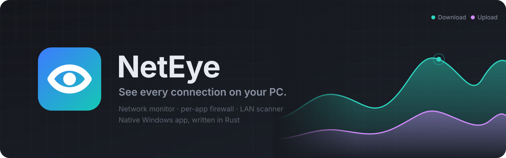

<p align="center">
  
</p>

<p align="center">
  
  
  
  
</p>

<p align="center">
  <a href="#features">Features</a> ·
  <a href="#getting-started">Getting started</a> ·
  <a href="#privacy">Privacy</a> ·
  <a href="#third-party-data">Credits</a>
</p>

**NetEye** is a fast, native network monitor and firewall for Windows. It shows which apps are using your connection, who they talk to and from which country, and lets you block any app with one click. It runs locally as a single small executable: no account, no cloud, no telemetry.

## Features

<table>
  <tr>
    <td width="50%" valign="top">
      <h3>📈 Traffic Monitor</h3>
      Live and historical bandwidth from 5 minutes to all time, with day, week and month steppers and custom ranges. Group traffic by app, publisher, traffic type or country, and filter by LAN/WAN and direction. A timeline scrubber, graph markers for events, pause, and CSV export.
    </td>
    <td width="50%" valign="top">
      <h3>🌍 Hosts &amp; countries</h3>
      Every host each app talked to, split by country with flags. Click a host for its IP (copy it or check it on VirusTotal) and per-app usage; click a country for all of its hosts. Country lookup is built in, so nothing is sent anywhere.
    </td>
  </tr>
  <tr>
    <td width="50%" valign="top">
      <h3>🛡️ Per-app firewall</h3>
      Allow or block each app's incoming and outgoing traffic with one click. Rules are persistent Windows Filtering Platform filters, so they work alongside Windows Firewall and third-party security suites. Optional Ask to Connect for new apps.
    </td>
    <td width="50%" valign="top">
      <h3>🔔 Activity log</h3>
      First network use by each app, internet drops and reconnects, app version changes, new devices on your network, and data-plan alerts, with filters, search and Mark all read.
    </td>
  </tr>
  <tr>
    <td width="50%" valign="top">
      <h3>📡 Network scanner</h3>
      Find every device on your LAN, pick which network to scan, name your devices, and get alerted when a new one joins. Vendor lookup comes from Wireshark's <code>manuf</code> database.
    </td>
    <td width="50%" valign="top">
      <h3>🧠 Hardware resources</h3>
      Per-app CPU, GPU, memory and disk use, with live system charts, so you can see what an app costs beyond the network.
    </td>
  </tr>
</table>

Also: light and dark themes, a tray icon that stays out of the way, sortable tables with a column chooser, and app details with file path, version, publisher and a VirusTotal hash check.

## Getting started

### Run

NetEye works without admin rights, but **run it as administrator** for the full picture:

| | Administrator | Standard user |
|---|---|---|
| Total traffic and graphs | ✅ | ✅ |
| Per-app and per-host bytes, countries, traffic types | ✅ | — |
| Firewall changes | silent | one UAC prompt per change |

Use **Restart as administrator** in the app to switch at any time.

### Build from source

You need Rust with the `x86_64-pc-windows-gnu` toolchain and MinGW-w64 (WinLibs) on `PATH`.

```bash
cargo build --release
```

The app is written to `target/release/neteye.exe`.

## Privacy

- Everything stays on your PC, in `%APPDATA%\NetEye`.
- There is no account, no telemetry and no update check.
- Country lookup uses a database bundled in the app; IP addresses are never sent to a geolocation service.
- Host names come from reverse DNS lookups through your own DNS server, as any app on your PC would do.
- To tell whether you're online, NetEye briefly opens a connection to well-known public DNS servers (1.1.1.1, 8.8.8.8, 9.9.9.9). Nothing is sent over it.
- The VirusTotal button hashes the file locally and opens its page in your browser. The file itself is never uploaded.

## Third-party data

NetEye bundles the following at build time. Nothing is downloaded at runtime.

- **Country lookup**: IP Geolocation by [DB-IP](https://db-ip.com), the "IP to Country Lite" database, release 2026-10, used unmodified (only decompressed). Licensed under [CC BY 4.0](https://creativecommons.org/licenses/by/4.0/). See `assets/geo/README.md` and `assets/geo/DBIP-LICENSE.txt`.
- **Country flags**: [flag-icons](https://github.com/lipis/flag-icons) v7.6.0 by lipis, MIT License. The SVGs were rasterised into an atlas; the artwork is unchanged. See `assets/flags/README.md` and `assets/flags/LICENSE`.
- **Font**: [Manrope](https://github.com/googlefonts/manrope) by The Manrope Project Authors, SIL Open Font License 1.1. See `assets/fonts/OFL.txt`.

## License

[MIT](LICENSE) © 2026 Idan Rubin
